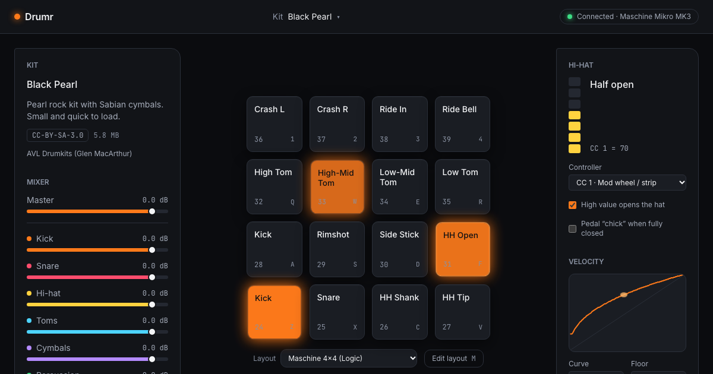

# Drumr

**Acoustic drums for your MIDI pads, in the browser.** Plug in a USB pad controller, pick a sampled kit, play. No DAW, no plugin, no account.

[**Try it →**](https://gauravsaluja2006.github.io/drumr/) &nbsp;·&nbsp; works without hardware too: click the pads or use the keyboard (`1234` `QWER` `ASDF` `ZXCV`).



## Why

I learned finger drumming in Logic Pro with a Drum Kit Designer kit and a small Scripter script ([`logic.js`](logic.js)) that remapped my Maschine pads, shaped velocity, and drove hi-hat openness from the touch strip. When the subscription ended, all of that went with it. Drumr rebuilds exactly that workflow on the open web, and reproduces the script's behaviour, verified by tests that execute the original code.

## What it does

- **Real acoustic kits.** Three kits from open-licence sample libraries, with multiple velocity layers and round robins: a small Pearl rock kit, a contemporary jazz kit, and a big 1980s rock kit with six hi-hat openings.
- **Your controller, your layout.** Web MIDI detects USB controllers and hot-plugs. Pads map to drum voices, not files, so a layout works with every kit. The default layout is the Maschine 4×4 layout from `logic.js`. Remap any pad by hitting it (MIDI learn), save layouts, and export or import them as JSON.
- **A hi-hat that behaves like one.** A CC strip or pedal moves the hat between closed and open. Closed, pedal and shank hits choke a ringing open hat in about 40 ms.
- **Feel.** Configurable velocity curve, per-kit group mixer, ~0.1 ms from MIDI event to scheduled sound.
- **Works offline** after the first visit, installs as an app, and runs on phones (touch) and in Safari (keyboard and touch; Safari has no Web MIDI).

## How it works

```
USB pad ──▶ Web MIDI ──▶ parse ──▶ pad → voice ──▶ resolve to kit articulation ──▶ Web Audio voice
                                    (mapping)       (fallbacks, hi-hat openness)    (velocity layer,
                                                                                    round robin, choke)
```

- The **MIDI → audio path is synchronous**: one JavaScript task from the MIDI event to `AudioBufferSourceNode.start()`. React only learns about hits through `requestAnimationFrame`-batched DOM attributes, so playing never re-renders the app.
- The **audio engine** is plain TypeScript over a small interface to Web Audio, with a 64-voice pool, group buses, and a safety limiter. It is unit tested with a fake `AudioContext` that records every scheduled parameter change.
- **Kits** are produced offline by a pipeline (`scripts/kit-pipeline`) that selects velocity layers and round robins, mixes close and overhead mics, normalises loudness, trims silence without touching transients, and encodes FLAC, all with provenance and licence files.

Built with TypeScript, React, Zustand, Zod, Tailwind CSS and Vite. Tested with Vitest and Playwright (Chromium, Firefox, WebKit), with a fake Web MIDI device injected into real browsers.

## Engineering numbers

| Metric | Result | Budget |
|---|---|---|
| MIDI event → sound scheduled (p95, Chromium) | 0.1 ms | ≤ 5 ms |
| Notes dropped (500 notes at 10 ms) | 0 | 0 |
| Frame rate while playing 200 hits | 60 fps | ≥ 55 fps |
| First playable, default kit at 50 Mbps | 1.2 s | ≤ 3 s |
| Initial JavaScript (gzip) | 109 KB | ≤ 180 KB |
| Unit test line coverage | 98 % | ≥ 80 % |

Every phase was built test-first against a written specification, with CI gates for lint, types, unit and end-to-end tests in three browsers, accessibility (axe), bundle size, visual regression and Lighthouse. Full history in [`docs/METRICS-LOG.md`](docs/METRICS-LOG.md).

## Run it locally

```sh
pnpm install
pnpm dev            # http://localhost:5173
pnpm test:unit      # Vitest
pnpm test:e2e       # Playwright, 3 browsers
```

Rebuilding kits needs the source libraries listed in [`KITS.md`](KITS.md) under `~/drumr-sources/`, then `pnpm kit:build-all`.

## Documentation

The project was specified before it was built. The specification is in [`docs/`](docs/00-OVERVIEW.md): product requirements, architecture and decision log, design system, phased roadmap with required tests, testing strategy, performance budgets, and the kit pipeline.

## Licences

Application code: [MIT](LICENSE).

Drum samples keep their own licences, shown in the app's About panel and in each kit folder:

| Kit | Samples by | Licence |
|---|---|---|
| Black Pearl | [AVL Drumkits](https://www.bandshed.net/avldrumkits/) (Glen MacArthur) | [CC BY-SA 3.0](https://creativecommons.org/licenses/by-sa/3.0/) |
| Virtuosity Jazz | [Versilian Studios & Karoryfer Lecolds](https://versilian-studios.com/virtuosity-drums/) | [CC0 1.0](https://creativecommons.org/publicdomain/zero/1.0/) |
| Big Rusty Rock | [Karoryfer Lecolds](https://shop.karoryfer.com/pages/free-big-rusty-drums) | [CC0 1.0](https://creativecommons.org/publicdomain/zero/1.0/) |
